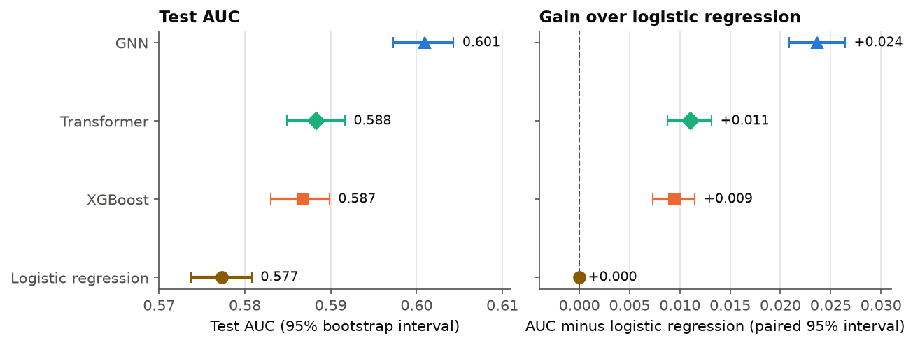
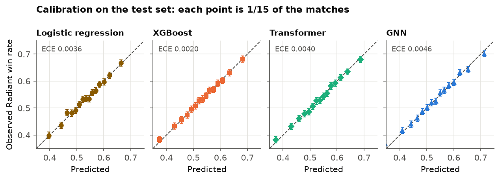
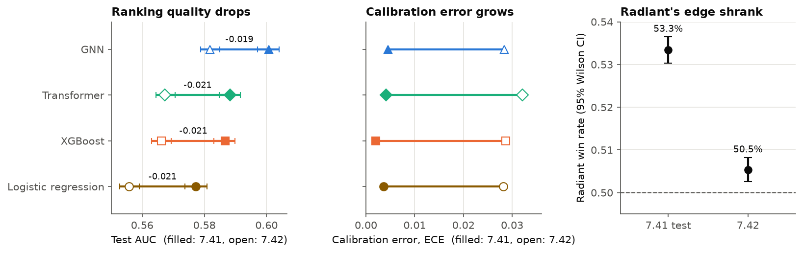
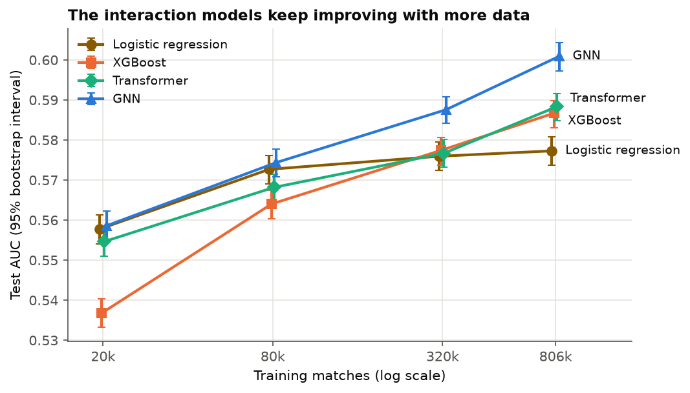

# Dota 2 Draft Win Predictor

**How much does the draft alone tell you about who wins a Dota 2 match?** This repository is
a benchmark of that question: logistic regression, XGBoost, a Transformer and a graph neural
network are trained on the same 806k ranked matches and scored by one evaluation harness on
the same 101k held-out matches. A pick recommender built on the models is included as a
Streamlit app.

Draft-based win prediction is a well-studied problem (see [Prior work](#prior-work)). The
contribution here is the evaluation: confidence intervals on every number, paired
comparisons between models, a calibration analysis, a patch-drift study, strict leakage
rules, and a reproducible pipeline from raw API data to the demo app.

A longer  write-up of the method and findings is in
[docs/report.md](docs/report.md).

## Results

1,007,319 ranked All Pick matches from patch 7.41 (13 May to 11 June 2026), split
chronologically 80/10/10. All numbers are on the 100,731-match test set and are produced by
`make benchmark` (`results/benchmark/table.md`).

| Model | AUC [95% CI] | ΔAUC vs logistic regression [95% CI] | Log-loss | Brier | ECE |
|---|---|---|---|---|---|
| GNN | 0.6009 [0.5973, 0.6043] | +0.0236 [+0.0209, +0.0264] | 0.6751 | 0.2411 | 0.0046 |
| Transformer | 0.5883 [0.5849, 0.5917] | +0.0110 [+0.0088, +0.0132] | 0.6786 | 0.2428 | 0.0040 |
| XGBoost | 0.5867 [0.5830, 0.5899] | +0.0094 [+0.0073, +0.0115] | 0.6791 | 0.2431 | 0.0020 |
| Logistic regression | 0.5773 [0.5738, 0.5808] | reference | 0.6815 | 0.2442 | 0.0036 |



AUC intervals are percentile bootstraps (1,000 resamples). ΔAUC is a paired bootstrap: both
models are scored on the same resampled matches. ECE uses 15 equal-width bins.

The ranking is GNN > Transformer ≈ XGBoost > logistic regression. By the same paired
bootstrap on `results/benchmark/predictions.parquet`, the GNN leads the Transformer by
+0.0126 [+0.0103, +0.0150], while the Transformer and XGBoost are tied
(+0.0016 [-0.0007, +0.0040]).

**What the numbers say**

- **The draft carries real but limited information.** The best model reaches an AUC of
  0.60. Player skill and in-game play, which the draft cannot see, decide most of a match.
- **Hero interactions matter, and the GNN uses them best.** Logistic regression can only
  add up per-hero strengths. All three models that can represent interactions beat it by a
  margin well clear of zero, and the GNN, which receives train-split synergy and counter
  statistics as its graph, leads by +0.024.
- **Predictions are well calibrated out of the box.** ECE is 0.002–0.005 for every model.
  Platt scaling and isotonic regression, fit on the validation set, do not improve it
  (`results/calibration/calibration_table.md`).



### Patch drift

Models trained on patch 7.41 are scored on their own held-out 7.41 matches and on 118,898
matches from patch 7.42 (19–22 November 2026), produced by `make drift-patch`
(`results/drift/patch_drift.csv`).

| Model | AUC on 7.41 | AUC on 7.42 | ΔAUC [95% CI] | ECE on 7.41 | ECE on 7.42 |
|---|---|---|---|---|---|
| GNN | 0.6007 | 0.5817 | −0.0190 [−0.0236, −0.0144] | 0.0045 | 0.0284 |
| Transformer | 0.5883 | 0.5673 | −0.0210 [−0.0254, −0.0160] | 0.0041 | 0.0322 |
| XGBoost | 0.5867 | 0.5661 | −0.0206 [−0.0251, −0.0155] | 0.0020 | 0.0287 |
| Logistic regression | 0.5773 | 0.5558 | −0.0215 [−0.0261, −0.0165] | 0.0036 | 0.0281 |

- **Every model loses about 0.02 AUC on the next patch,** roughly the gap between the best
  and the simplest model. The ranking of the models is unchanged.
- **Calibration degrades far more than ranking:** ECE grows six- to fourteen-fold. The
  main cause is visible in the data: Radiant wins 53.2% of 7.41 matches and 50.5% of 7.42
  matches, and each model still carries the old side advantage.
- A model in production should be retrained on each patch, or at least have its intercept
  refit.
- **Within a patch there is no measurable decay.** Trained on the first 54% of the 7.41
  matches and scored on five consecutive later windows (up to ten days after the end of
  training), every model's AUC stays within 0.008 with no trend (`make drift`,
  `results/drift/time_drift.csv`).



### Ablations

Each ablation is a separately tagged run on the same split; none of them enters the
headline table.

**Training-set size** (test AUC):

| Training matches | Logistic regression | GNN | Transformer | XGBoost |
|---|---|---|---|---|
| 20,000 | 0.5577 | 0.5586 | 0.5546 | 0.5368 |
| 80,000 | 0.5727 | 0.5744 | 0.5682 | 0.5640 |
| 320,000 | 0.5759 | 0.5876 | 0.5767 | 0.5774 |
| 805,857 | 0.5773 | 0.6009 | 0.5883 | 0.5867 |



Logistic regression saturates near 80k matches. XGBoost and the Transformer are worse than
logistic regression with little data and only overtake it past 320k; the GNN is never
behind. The interaction models are still improving at 806k.

**Mirror augmentation** (each match also seen with teams swapped and the label flipped,
with the side advantage restored as a fixed logit offset):

| Model | Validation AUC without → with | Test AUC without → with |
|---|---|---|
| GNN | 0.6019 → 0.6055 | 0.6009 → 0.6048 |
| Transformer | 0.5898 → 0.5982 | 0.5883 → 0.5973 |
| XGBoost | — | 0.5867 → 0.5914 |
| Logistic regression | — | 0.5773 → 0.5773 |

Mirroring helps every model that learns interactions and leaves logistic regression
unchanged. It is the most effective change tested.

**Rank feature.** Adding the match's average rank tier as an input changes nothing (GNN
0.6005 with rank, 0.6009 without). The exploratory analysis shows that 68 of 127 heroes do
have different win rates in low and high brackets, so this result says the models do not
learn hero-by-rank interactions from a single appended number, not that rank is irrelevant.

**Pick masking.** Training with 15% of hero slots randomly hidden, so that partial drafts
are in-distribution for the recommender, costs little on full drafts (Transformer 0.5877
against 0.5883, GNN 0.5973 against 0.6009).

### What the data shows

From `notebooks/eda.ipynb`, on all 1,007,319 matches:

- Radiant wins **53.19%** of matches (95% Wilson interval 53.09–53.29%), with little
  dependence on rank bracket (52.8–53.4%).
- Hero win rates (pooled over sides) range from 42.5% to 54.8%. For 103 of 127 heroes the
  95% interval excludes 50%.
- Pair effects are small. The median same-team pair has 1,438 games, and empirical-Bayes
  shrinkage keeps about a quarter of the typical raw synergy (median shrink factor 0.27).
  The strongest shrunk synergies are about ±0.08 log-odds. Counters carry more signal, up
  to 0.30 log-odds (Anti-Mage against Medusa).
- Win rates move within a patch: between the first and second half of the 30-day window,
  23 of 127 heroes shift significantly (Benjamini–Hochberg, q ≤ 0.05).
- Rank matters for individual heroes: 68 of 127 have significantly different win rates
  between Herald–Crusader and Legend–Divine matches.

## Demo

`make app` starts the Streamlit app locally: build both line-ups, see the predicted win
probability and the ten best next picks for either side. It works straight after cloning,
with no data collection or training: the repository ships the training-split statistics
(`data/artifacts/`) and two trained checkpoints (`models/release/`, logistic regression and
XGBoost). Models trained locally into `models/` appear in the model picker as well.

```bash
pip install -r requirements.txt     # slim runtime: no PyTorch needed for the shipped models
streamlit run app/streamlit_app.py
```

## Quickstart

```bash
make install        # venv + pip install -e ".[dev]"   (make install-all adds torch, streamlit, wandb)
make data           # collect 1M patch-7.41 matches from OpenDota (free tier, resumable) + validate
make collect-drift  # collect the second patch (7.42) for the drift study
make heroes         # hero id -> name cache (data/artifacts/heroes.json)
make artifacts      # train-split stats for the app (no training needed)
make app            # Streamlit demo, stats mode works with zero trained models

make test           # fast test suite (synthetic data only)
make eda            # execute the EDA notebook headless -> results/eda/
make train-baselines
make train-transformer                              # add ARGS="--epochs 30 --wandb"
make train-transformer TAG=rec ARGS="--pick-dropout 0.15"   # recommender checkpoint
make train-gnn
make benchmark      # harness: baselines fit fresh, torch models loaded from models/
make calibrate      # Platt / isotonic on val, evaluated on test
make drift          # within-patch stability over consecutive time windows
make drift-patch    # train on patch 7.41, test on patch 7.42
make figures        # regenerate the README and report figures in docs/figures/
```

Every script is a thin `argparse` wrapper (`python scripts/<name>.py --help`). If data or
checkpoints are missing, the script prints what to run and exits cleanly.

## Repository map

```
app/                      Streamlit demo: live P(win) + top-10 picks, hero portraits
data/raw/                 parquet shards of the benchmark patch (not committed)
data/patch-742/           second patch, read only by the drift study (not committed)
data/artifacts/           small committed stats built from the TRAIN split only
docs/architecture.md      module contract: interfaces, formulas, leakage rules
docs/report.md            plain-language report of the method and findings
docs/figures/             figures used in the README and the report
notebooks/eda.ipynb       exploratory analysis     (calls src.stats; no inline formulas)
scripts/                  CLI entry points (fetch, build artifacts, train, benchmark, calibrate, drift)
src/data/                 OpenDota collector, validation, loading, chronological/patch splits
src/stats/                Wilson CI, synergy/counter matrices with EB shrinkage, z-tests + BH
src/features/             one-hot / index encodings, mirror augmentation
src/models/               DraftModel interface; logreg, XGBoost, Transformer, GNN
src/eval/                 metrics, calibration, the benchmark harness, drift studies
src/recommend/            score every legal pick for the side to move
tests/                    pytest on synthetic data with planted synergy/counter signal
```

## Methodology

**Data.** OpenDota public matches (the `public_matches` table, read through the SQL
explorer endpoint in bulk or through `/publicMatches`), filtered to ranked lobby, All Pick, duration ≥ 15 min,
and 5+5 unique valid heroes. Match fields: hero ids per side, outcome, average rank tier,
start time, patch. The data has no bans and no pick order.

**Splits.** Chronological, never shuffled: 80/10/10 train/val/test by start time. The split
is deterministic, so the harness, calibration analysis and artifact builder all see the
same rows. For patch drift, a model is trained on patch N and tested on all of patch N+1.

**Leakage rules.** Anything used as a model input (synergy/counter matrices for the GNN
graph, app artifacts) is computed from the train split only. Augmentation runs on train
only. Recalibrators are fit on val and applied to test. The test set is used only inside
the harness: training scripts report validation metrics.

**Side bias.** Radiant wins about 53%. The headline benchmark trains every model without
mirror augmentation, so each model learns the side bias from data. Mirror augmentation
(swap teams, flip label) is an ablation. A model trained with it gets back a fixed logit
offset `logit(mean(train.radiant_win))`, so mirroring cannot erase the side bias.

**Fair comparison.** All four models go through one harness with the same policy (no
mirror, no pick dropout, no rank feature). Each model gets an AUC with a bootstrap 95% CI,
plus a **paired** bootstrap ΔAUC against logistic regression (the same resampled rows for
both models), log-loss, Brier, and ECE (equal-width and equal-mass bins). Ablations
(`--use-rank`, `--mirror`, `--pick-dropout`, train-size `--sample`) are tagged runs and
never appear in the headline rows.

**Pair statistics.** Synergy and counter scores are in log-odds:
synergy `logit(pair_wr) − logit(wr_a) − logit(wr_b)`; counter averages the two side
orientations so the radiant advantage cancels. Both are shrunk toward 0 with an
empirical-Bayes normal prior (precision-weighted method of moments). Caveat: marginal win
rates attenuate the true interaction coefficients, so these numbers are approximations.

**Calibration.** Reliability curves with Wilson error bars, then Platt and isotonic
recalibration fit on val and evaluated on test. Both are clipped so log-loss stays finite.

**Drift.** *Time mode* (works on one patch): train on the earliest 54%, validate on the
next 6%, then score consecutive later windows. *Patch mode*: train on patch N, compare the
within-patch test score with the score on patch N+1.

**Recommender.** For each legal hero, add it to the picking side and score the draft with
any `DraftModel`. Only models trained with pick masking (`--pick-dropout > 0`) see partial
drafts during training; neural models trained without it become overconfident when heroes
are missing. The report includes a check of every model on partial drafts.

## Prior work

- **andreiapostoae/dota2-predictor** (GitHub): logistic regression on hero one-hot vectors
  from OpenDota data, with a pick-suggestion tool. The classic open-source baseline for
  this task.
- **Draftnet** (GitHub, `viking-sudo-rm/draftnet`): a feed-forward "bag-of-heroes" network
  that learns hero embeddings from professional Captain's Mode drafts and suggests picks
  and bans.
- K. Conley and D. Perry, *How Does He Saw Me? A Recommendation Engine for Picking Heroes in
  Dota 2*, Stanford CS229 project report, 2013. Logistic regression and k-nearest neighbors
  on hero picks.
- A. Semenov, P. Romov, S. Korolev, D. Yashkov, K. Neklyudov, *Performance of Machine
  Learning Algorithms in Predicting Game Outcome from Drafts in Dota 2*, AIST 2016
  (Springer CCIS). Compares naive Bayes, logistic regression and gradient-boosted trees, and
  introduces factorization machines; reports that prediction quality depends on skill
  bracket.
- S. Chen, M. Zhu, D. Ye, W. Zhang, Q. Fu, W. Yang, *Which Heroes to Pick? Learning to Draft
  in MOBA Games with Neural Networks and Tree Search*, arXiv:2012.10171 (JueWuDraft, Honor
  of Kings). Neural value networks combined with MCTS for drafting.
- Graph neural networks over hero or player interaction graphs have also been applied to
  Dota 2 outcome prediction. The GNN here is a small dense variant over shrunk synergy and
  counter adjacency matrices.

Figures in these works are not directly comparable to ours: datasets, skill brackets,
patches and metrics differ (accuracy vs AUC, random vs chronological splits). Making those
choices explicit and identical across models is the point of this benchmark.

## Limitations

- **One training patch, one drift pair.** Models are trained on patch 7.41 only, and drift
  is measured on a single transition (7.41 to 7.42), five months apart. The 7.42 sample
  covers the first four days of that patch.
- **No hyperparameter search.** Every model uses fixed, untuned settings so that all four
  are treated alike; the reported scores are not each model's best achievable.
- **Single training seed.** Bootstrap intervals capture test-set sampling noise, not
  run-to-run variation of the neural models.
- **Test set reused across ablations.** The headline table and every ablation are scored
  on the same test matches; ablation conclusions are checked against validation scores
  where those exist.
- **Draft only.** No player identity, MMR per player, roles or lane assignments, which is
  why the AUC stays near 0.60.
- **No bans and no pick order.** The public-match data does not provide them, so drafts are
  modeled as sets and the recommender cannot reason about pick order or what the opponent
  will pick next.
- **Public matchmaking only.** Results do not transfer to professional Captain's Mode drafts.
- **Stats mode in the app is a heuristic.** It adds the side bias, single-hero
  win rates and shrunk pair effects as if they were independent. Its probabilities are not calibrated.

## License and data

Code is released under the [MIT License](LICENSE).

Match data comes from the
[OpenDota API](https://docs.opendota.com/) (free tier) and is not redistributed. Only small
aggregate artifacts are committed. Hero names and images are property of Valve Corporation;
this project is not affiliated with Valve.
