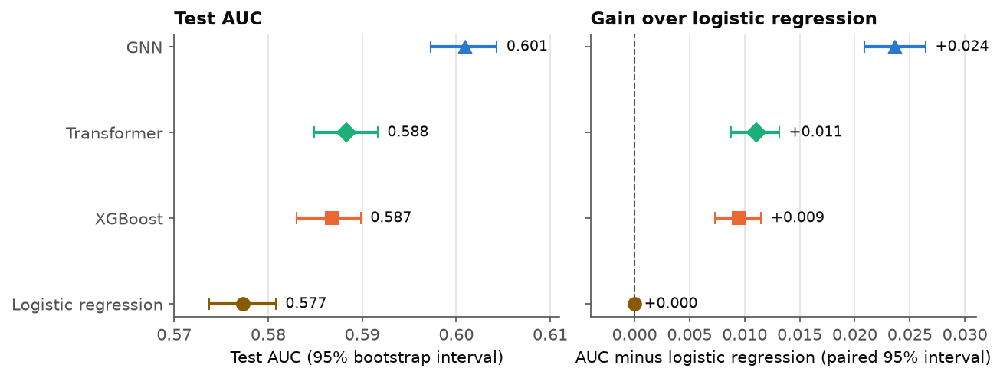
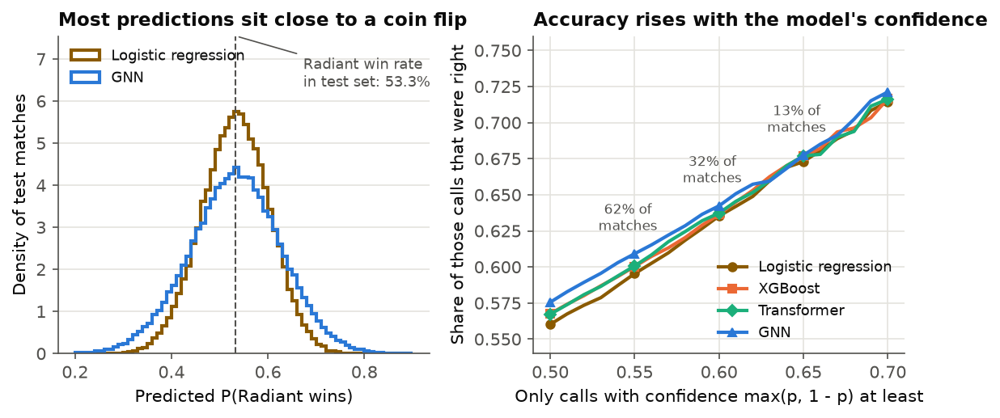
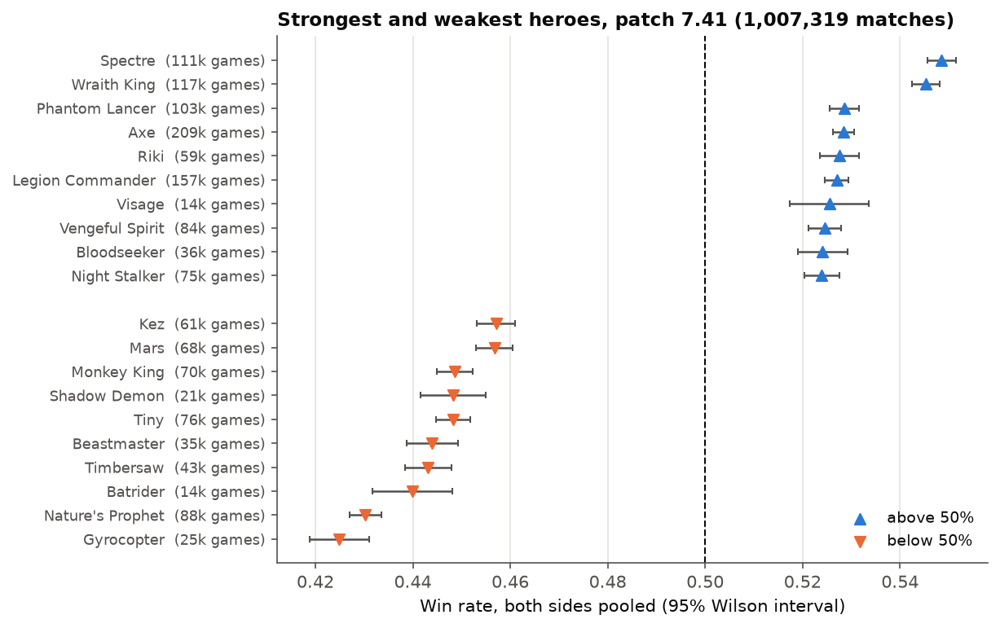
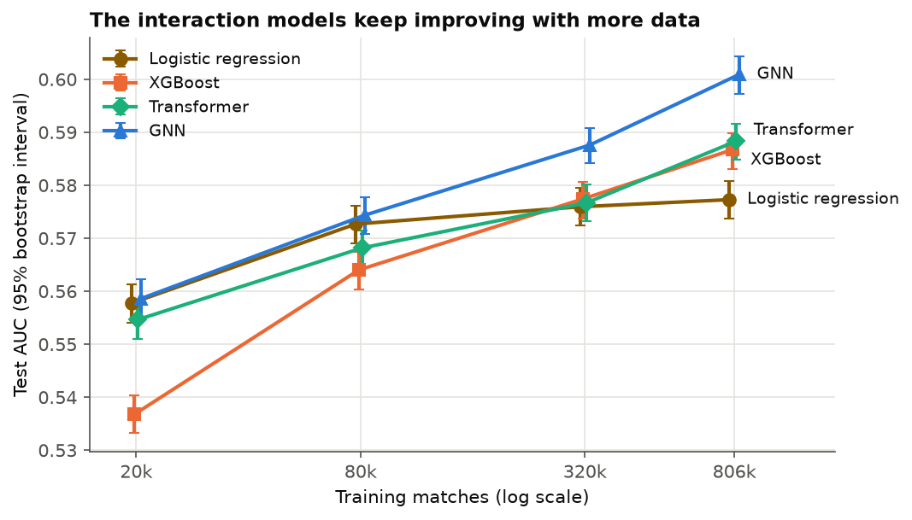
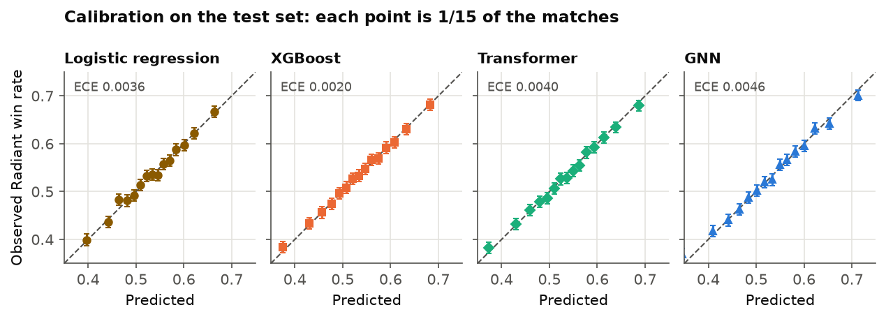
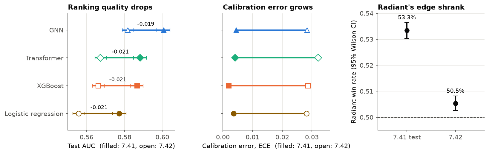
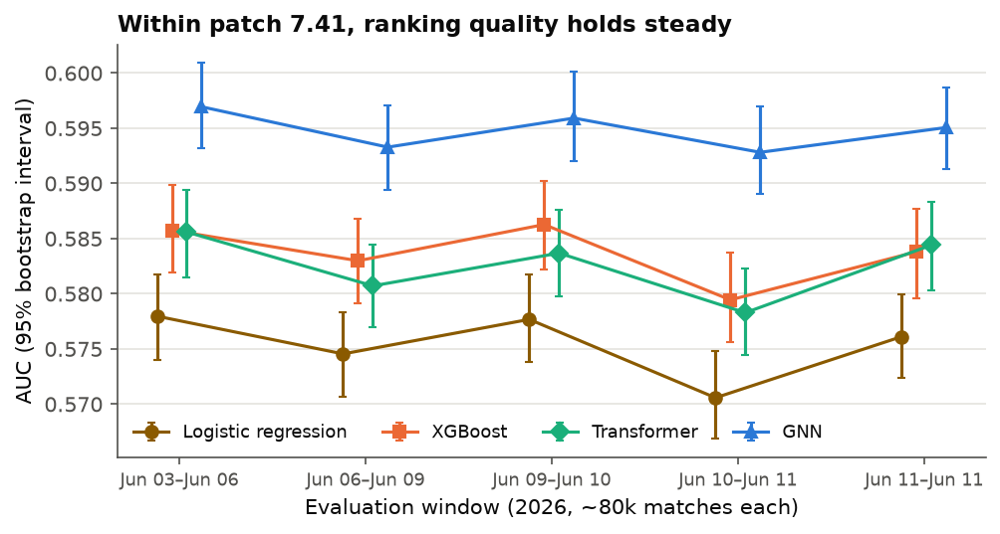

# How much does the draft decide a Dota 2 match?

A benchmark of draft-only win prediction: four models, one million ranked matches, one
evaluation harness, and a test on the next game patch.

## Summary

In Dota 2, two teams of five players each pick a different hero before the match starts.
This set of ten picks is the **draft**. This project asks how well the draft alone, with
nothing known about the players, predicts which team wins, and whether more expressive
models extract more from it than a simple one.

Four models were trained on the same 805,857 ranked matches from game version 7.41 and
scored on the same 100,731 later matches:

| Model | Test AUC [95% interval] | Gain over logistic regression [95% interval] |
|---|---|---|
| Graph neural network (GNN) | 0.601 [0.597, 0.604] | +0.024 [+0.021, +0.026] |
| Transformer | 0.588 [0.585, 0.592] | +0.011 [+0.009, +0.013] |
| XGBoost | 0.587 [0.583, 0.590] | +0.009 [+0.007, +0.012] |
| Logistic regression | 0.577 [0.574, 0.581] | reference |

AUC is explained in the next section; 0.5 is a coin flip and 1.0 is perfect foresight.
The four findings worth keeping:

1. **The draft carries a real but small signal.** The best model ranks a won match above a
   lost one 60% of the time and calls the winner correctly in 57.6% of matches, against
   53.3% for always backing the Radiant side.
2. **Hero interactions matter, but only with enough data.** A model that just adds up hero
   strengths stops improving at around 80,000 training matches. Models that can represent
   synergies and counters start behind it or level with it, pull ahead from around 320,000
   matches and are still improving at 806,000.
3. **The predicted probabilities are honest.** On the test set, a predicted 60% chance
   corresponds to about 60% observed wins for every model. Recalibration does not improve
   them.
4. **A game update breaks this.** After patch 7.42, every model loses about 0.02 AUC and
   its calibration error grows from about 0.004 to about 0.03. Roughly half of that
   calibration error is the shrinking advantage of the Radiant side, which a one-number
   correction fixes. The rest needs retraining.



## The question and why it is hard

A Dota 2 match is played by two teams, **Radiant** and **Dire**, who start in opposite
corners of the map. Before the game, each player picks one of 127 heroes, and no hero can
appear twice. Heroes differ in strength, and some combinations work well together (a hero
that holds enemies in place next to one that deals heavy damage) or badly against each
other (a hero whose abilities are neutralised by one specific opponent). Players discuss
the draft at length, so it is natural to ask how much of the result it decides.

The honest answer is "not much", and the reason is what the draft leaves out. The outcome
depends mostly on the ten players: their skill, their coordination, their mistakes over a
40-minute game. Matchmaking also tries to pair teams of similar skill, which removes the
easiest signal. A draft-only model therefore cannot be very accurate, and the interesting
questions are how much signal there is, which models extract it, and whether their
probability estimates can be trusted.

**What "AUC 0.60" means.** The AUC (area under the ROC curve) measures how well a model
ranks matches. Take one match that Radiant won and one that Radiant lost, both picked at
random from the test set. The AUC is the probability that the model gives the won match the
higher Radiant win probability. A model that guesses gets 0.5; a model that always ranks
correctly gets 1.0. The GNN's 0.601 means it orders such a pair correctly 60 times out of
100.

A more concrete reading comes from looking at how confident the predictions are (figure
below, computed from the saved test predictions). Most drafts look close to even: half of
the GNN's predictions fall between 47% and 60% for Radiant. When the GNN is at least 60%
confident in one side, which happens in 32% of matches, that side wins 64% of the time; at
70% confidence or more (4.4% of matches) it wins 72% of the time. The 10% of drafts the GNN
rates best for Radiant end in a Radiant win 68.7% of the time; the 10% it rates worst, 38.0%
of the time.



## The data

**Source.** Matches come from the public [OpenDota API](https://docs.opendota.com/), which
records the result and the ten heroes of public matches. Each match also carries its start
time, duration and the average skill medal of its players (from Herald, the lowest, to
Immortal). The collector keeps only:

- ranked matchmaking games in the All Pick mode (the standard ranked mode),
- games of at least 15 minutes (shorter games are usually abandons),
- drafts with five distinct heroes per team.

**Size and span.** The main data set has **1,007,319 matches** from patch 7.41, played
between 2026-05-13 and 2026-06-11. A **patch** is a game update in which the developer
changes hero abilities and items; each patch shifts which heroes are strong. A second set
of **118,898 matches** from the following patch, 7.42, played between 2026-11-19 and
2026-11-22, is used only for the drift study. The collector samples evenly over most of
the 7.41 window (about 29,000 matches per day) but more densely over its last two days
(229,000 matches on June 10–11). This matters for the split described below.

**The side advantage.** Radiant wins **53.19%** of the 7.41 matches (95% Wilson interval
53.09–53.29%). A **95% confidence interval** is a range built so that, over repeated
samples, it covers the true value 95% of the time; the Wilson interval is a version for
proportions that stays reliable near 0% or 100%. The advantage is the same in every skill
bracket (52.8–53.4%). Any model has to learn it, and, as the drift study shows, it changes
between patches.

**Hero strength.** Pooled over both sides, hero win rates range from 42.5% (Gyrocopter) to
54.8% (Spectre). With hundreds of thousands of matches the intervals are narrow, and 103 of
127 heroes have an interval that excludes 50%. The spread is still small: even the
strongest hero loses 45% of its games.



**Pairs of heroes.** The exploratory notebook (`notebooks/eda.ipynb`) measures, for every
pair of heroes, how much more often they win together (synergy) or against each other
(counter) than their individual win rates predict. Pair estimates are noisy, so they are
shrunk toward zero in proportion to their uncertainty (empirical-Bayes shrinkage). The
strongest same-team effects are small: Necrophos with Spirit Breaker is the top synergy at
+0.08 on the log-odds scale, roughly two percentage points of win rate. Counters are
larger: Anti-Mage against Medusa reaches +0.30 log-odds, about seven points. This is
consistent with the game: Anti-Mage burns the mana that Medusa's shield depends on.

**Stability.** Hero win rates move even without a patch. Between the first and second half
of the 7.41 window, 23 of 127 heroes shift by a statistically significant amount after
correcting for testing 127 heroes at once (Benjamini–Hochberg, false discovery rate 5%);
Huskar loses 2.9 points. Between low brackets (Herald to Crusader) and high brackets
(Legend to Divine), 68 of 127 heroes differ significantly, by up to 4.4 points
(Bristleback). These facts come back below.

**What the data does not contain.** No player identities or per-player skill, no roles or
lane assignments, no bans and no pick order. Drafts are therefore treated as two
unordered sets of five heroes. Professional matches, which use a different draft format,
are not included.

## Comparing models fairly

Three rules keep the comparison honest.

**A chronological split.** The 7.41 matches are sorted by start time and cut into 80%
training (805,857 matches), 10% validation (100,731) and 10% test (100,731). The models
learn from the training set, the validation set is used to decide when to stop training
and to choose between variants, and the test set is used once per model for the reported
numbers. Because the split follows time, every model predicts matches that happened after
everything it learned from, as a deployed model would. Because the collector sampled the
last two days more densely, the validation set covers about 8 hours of June 10–11 and the
test set the following 9 hours of June 11.

**No leakage.** Leakage is any route by which information from the evaluation matches
reaches the model during training, which inflates scores. Every statistic a model receives
as input, such as the hero-pair table the GNN is built on, is computed from the training
matches only. Data augmentation is applied to training matches only. Recalibration is fit
on the validation set and only evaluated on the test set.

**One harness, paired comparisons.** A single evaluation module scores every model on the
identical test matches with the same metrics. Uncertainty comes from the **bootstrap**:
the test set is resampled with replacement 1,000 times and the metric recomputed each
time; the middle 95% of those values forms the interval. Differences between two models
use a **paired** bootstrap: both models are scored on the same resampled matches, so the
match-to-match difficulty that both models share cancels. This is why a difference of
0.009 can be clearly non-zero even though the two models' individual intervals overlap.

Besides AUC, the harness reports the **log-loss** (the average penalty $-\log p$ for the
probability $p$ given to the actual outcome; lower is better, and a constant 50% guess
scores 0.693), the **Brier score** (mean squared error of the probability), and the
**calibration error** described further below.

The neural networks were each trained once, with a fixed random seed. The bootstrap
intervals therefore describe the uncertainty that comes from the finite test set, not the
variation between two training runs of the same network. Where two models are close, that
second source of variation could change their order.

## The four models

All four models receive the same input: which heroes Radiant picked and which heroes Dire
picked. They differ in what they can represent.

**Logistic regression** gives each hero one weight for being on Radiant and one for being on
Dire, adds the ten weights to a constant, and converts the sum into a probability. It can
learn that Spectre is strong and that Radiant has an edge, but nothing about combinations:
in this model, Anti-Mage is exactly as useful against Medusa as against any other hero.
It is the standard baseline in prior work and trains in about four seconds.

**XGBoost** is a gradient-boosted ensemble of decision trees on the same 254 hero
indicators. Each tree can split on several heroes in sequence ("Anti-Mage on Radiant and
Medusa on Dire"), so it can learn interactions, but it has to discover each one from data,
hero by hero.

**The Transformer** treats the draft as a set of ten tokens. Each hero is represented by a
learned vector (an **embedding**), each token is tagged with its team, and two layers of
self-attention let every hero's representation depend on the nine others. The output is a
win probability. Because heroes share an embedding space, what the model learns about one
hero's interactions can transfer to heroes with similar embeddings. There is no position
information inside a team: the draft is a set, not a sequence.

**The graph neural network (GNN)** starts from a graph whose nodes are the 127 heroes and
whose weighted edges are the shrunk synergy and counter scores, computed on the training
matches only. Two rounds of message passing let each hero's vector absorb information from
the heroes it combines well or badly with. A match is then scored from the average vector
of each team and their difference, passed through a small neural network. Of the four
models, this is the only one that receives pairwise statistics as a starting point rather
than having to learn them from scratch.

Both neural models are small (64-dimensional embeddings, two layers) and were trained with
early stopping on validation log-loss.

## Results

The headline table and figure in the summary come from `results/benchmark/table.md`. The
full metrics:

| Model | AUC [95% CI] | Log-loss | Brier | Calibration error (ECE) |
|---|---|---|---|---|
| GNN | 0.6009 [0.5973, 0.6043] | 0.6751 | 0.2411 | 0.0046 |
| Transformer | 0.5883 [0.5849, 0.5917] | 0.6786 | 0.2428 | 0.0040 |
| XGBoost | 0.5867 [0.5830, 0.5899] | 0.6791 | 0.2431 | 0.0020 |
| Logistic regression | 0.5773 [0.5738, 0.5808] | 0.6815 | 0.2442 | 0.0036 |

A constant prediction equal to the test-set Radiant rate scores a log-loss of about 0.691,
so the best model removes about 2% of the uncertainty about the winner. All three
interaction models beat logistic regression with paired intervals that exclude zero. The
GNN beats the Transformer by +0.013 [+0.010, +0.015] and XGBoost by +0.014 [+0.012,
+0.017]. The Transformer and XGBoost cannot be separated: the Transformer's lead is
+0.0016 with a paired interval of [−0.0007, +0.0040], and a second training seed could
reverse it.

### More data favours the interaction models

The ranking above depends on how much data the models see. The same four models were
retrained on the first 20,000, 80,000 and 320,000 training matches and scored on the same
test set.



| Training matches | Logistic regression | XGBoost | Transformer | GNN |
|---|---|---|---|---|
| 20,000 | 0.558 | 0.537 | 0.555 | 0.559 |
| 80,000 | 0.573 | 0.564 | 0.568 | 0.574 |
| 320,000 | 0.576 | 0.577 | 0.577 | 0.588 |
| 805,857 | 0.577 | 0.587 | 0.588 | 0.601 |

Logistic regression gains 0.015 from 20,000 to 80,000 matches and only 0.005 over the next
ten-fold increase: with one weight per hero and side, it has little left to learn once
each hero has been seen a few thousand times. XGBoost starts far behind (0.537), because
trees fit noise when interactions are rare, and gains 0.050 over the range. The
Transformer is below logistic regression up to 80,000 matches and level with it at
320,000. The GNN never falls behind and pulls clearly ahead from 320,000 matches on. None
of the three interaction models has flattened at the full training set: from 320,000 to
805,857 matches they gain 0.009–0.013 AUC, all with paired intervals that exclude zero.

This explains an earlier result. On a first collection of 200,000 matches, the four models were within 0.009 AUC of each other and none beat
logistic regression by more than 0.004. That run used a different, smaller test set, so
its numbers are not comparable with the table above; the training-size experiment, which
holds the test set fixed, is the cleaner evidence for the same conclusion. Interactions
between heroes carry real signal, and a model needs hundreds of thousands of matches to
estimate them, because each of the roughly 8,000 hero pairs appears in only a small
fraction of matches.

### What else helped, and what did not

Three variants were tested against the standard configuration. Each was judged first on
the validation set, then confirmed on the test set with a paired comparison.

| Variant | Model | Validation AUC (standard → variant) | Test AUC change [paired 95% CI] |
|---|---|---|---|
| Mirror augmentation | Logistic regression | 0.5774 → 0.5776 | +0.0000 [−0.0004, +0.0005] |
| | XGBoost | 0.5876 → 0.5930 | +0.0046 [+0.0029, +0.0064] |
| | Transformer | 0.5898 → 0.5982 | +0.0090 [+0.0068, +0.0115] |
| | GNN | 0.6019 → 0.6055 | +0.0039 [+0.0025, +0.0052] |
| Skill-bracket input | Logistic regression | 0.5774 → 0.5775 | +0.0000 [−0.0000, +0.0001] |
| | XGBoost | 0.5876 → 0.5902 | +0.0014 [+0.0000, +0.0027] |
| | Transformer | 0.5898 → 0.5881 | +0.0005 [−0.0012, +0.0023] |
| | GNN | 0.6019 → 0.6013 | −0.0004 [−0.0020, +0.0010] |
| Masked picks (15%) | Transformer | 0.5898 → 0.5884 | −0.0007 [−0.0023, +0.0011] |
| | GNN | 0.6019 → 0.5974 | −0.0037 [−0.0051, −0.0023] |

**Mirror augmentation helps.** Every training match is added a second time with the teams
swapped and the result flipped. This doubles the training data and forces the model to
value a hero the same way on either side. Since that would erase the real Radiant
advantage, a fixed offset equal to the training-set advantage is added back at prediction
time. The three interaction models gain 0.004–0.009 AUC, consistent with the finding that
they are short of data; logistic regression, which is already saturated, gains nothing.
The best configuration overall is the mirrored GNN at 0.6048 [0.6012, 0.6081]. The
headline table keeps all four models without augmentation, so that they are compared under
the same policy. One cost: the mirrored Transformer's calibration error is 0.0117, about
three times that of the standard Transformer.

**The skill-bracket input does not help.** Adding the match's average skill medal as an
input changes AUC by less than 0.002 for every model. This does not mean skill is
irrelevant to the draft: the exploratory analysis shows that 68 of 127 heroes have
significantly different win rates in low and high brackets. The match-level medal mostly
says how good both teams are, which does not favour either side; what it could add is a
change in each hero's value by bracket, and none of these models was given a direct way to
learn that (for instance, explicit hero-by-bracket terms). The null result is about this
way of using rank, not about rank itself.

**Masking has a small cost.** The recommender needs predictions for unfinished drafts. In
the masked variant, each hero is hidden with probability 15% during training, so the model
sees incomplete drafts. On complete test drafts this costs the Transformer nothing
measurable and the GNN 0.004 AUC.

## Calibration: can the probabilities be taken at face value?

A model is **calibrated** if its probabilities mean what they say: among all the drafts it
gives 60%, Radiant should win about 60%. Ranking quality and calibration are separate
properties: a model can rank matches well and still say 90% when it should say 60%. For a
win-probability display, calibration is what the user actually reads.

The check groups test matches by predicted probability and compares each group's average
prediction with its observed Radiant win rate. The **expected calibration error (ECE)** is
the average gap, weighted by group size (15 equal-width groups).



All four models are well calibrated on the test set: every group lies on or next to the
diagonal, and the ECE is between 0.0020 and 0.0046, that is, a typical gap below half a
percentage point. This is at the level that chance alone produces: simulating outcomes
from the GNN's own probabilities (200 simulated test sets, so that the model is perfectly
calibrated by construction) gives an ECE of 0.0032 on average and up to 0.0049 at the
95th percentile.

Because the models are already calibrated, recalibration does not help. Two standard
methods, Platt scaling (a logistic fit on top of the predictions) and isotonic regression
(a monotone step function), were fit on the validation set and applied to the test set
(`results/calibration/calibration_table.md`). Both raise the ECE (to 0.0050–0.0061) and
change log-loss by at most 0.001. A likely contributor is that the validation set's
Radiant rate (52.8%) is lower than the test set's (53.3%), so a calibrator fit on it pulls
predictions in the wrong direction.

## Patch drift: what happens after a game update

Most published draft models are evaluated on matches from the same period as their
training data. In practice, a model is trained once and then used while the game keeps
changing. Patch 7.42 changed hero abilities and items. To measure the effect, the models
trained on 7.41 were applied, unchanged, to the 118,898 matches collected in the first
days of 7.42, and compared with their scores on the 7.41 test set
(`results/drift/patch_drift.csv`; the study retrains its models with the same settings,
so the 7.41 scores match the headline table to within 0.0002).



| Model | AUC on 7.41 | AUC on 7.42 | Change [95% CI] | ECE on 7.41 | ECE on 7.42 |
|---|---|---|---|---|---|
| GNN | 0.601 | 0.582 | −0.019 [−0.024, −0.014] | 0.0045 | 0.0284 |
| Transformer | 0.588 | 0.567 | −0.021 [−0.025, −0.016] | 0.0041 | 0.0322 |
| XGBoost | 0.587 | 0.566 | −0.021 [−0.025, −0.015] | 0.0020 | 0.0287 |
| Logistic regression | 0.577 | 0.556 | −0.021 [−0.026, −0.017] | 0.0036 | 0.0281 |

**Ranking quality.** Every model loses about 0.02 AUC, which is about as much as the GNN
gained over logistic regression in the first place. The losses are statistically
indistinguishable between models, so no model is more robust to the update than the others;
the GNN stays on top because it started higher. For comparison, a separate run that trains
on the first 54% of the 7.41 matches and scores five consecutive later windows, covering
the last eight days of the 7.41 data, sees AUC move by less than 0.01 between windows, with
intervals that mostly overlap (figure below, `results/drift/time_drift.csv`). The drop at
the patch boundary is of a different size from the normal variation inside a patch.



**Calibration.** The calibration error grows six- to fourteen-fold, to about 0.03, far
above the 0.003–0.005 that chance produces on a test set of this size. The biggest single
reason is visible in the third panel: in 7.42, Radiant wins only **50.54%** of matches
(95% interval 50.25–50.82%), against 53.2% in 7.41. The models still predict Radiant at
about 53% on average, because that is the advantage they learned.

**How much a simple correction recovers.** To separate the side advantage from everything
else, a single constant was added to each model's log-odds output (an intercept shift),
chosen so that the average prediction matched the observed Radiant rate on the first 10%
of 7.42 matches (11,889 matches, the first 10 hours). The corrected models were then
evaluated on the remaining 90%. This uses the saved benchmark models, whose 7.42 scores
match the drift study's to within 0.0006 ECE and 0.0003 AUC (the drift study retrains its
own GNN).

| Model | ECE on later 7.42, uncorrected | ECE after intercept shift | Log-loss, uncorrected → corrected |
|---|---|---|---|
| Logistic regression | 0.0287 | 0.0150 | 0.6904 → 0.6891 |
| XGBoost | 0.0288 | 0.0151 | 0.6885 → 0.6872 |
| Transformer | 0.0320 | 0.0162 | 0.6884 → 0.6865 |
| GNN | 0.0288 | 0.0179 | 0.6847 → 0.6833 |

The shift removes 38–50% of the calibration error. Fitting it on all of 7.42 instead (an
optimistic upper bound) does only slightly better (ECE 0.014–0.017), so the remaining half
is not a matter of estimating the shift better. It comes from the heroes: the patch changed
which heroes are strong and which combinations work, and no constant can correct that. The
intercept shift does not change the order of predictions, so it does not recover any AUC.

**What a deployed system should do.** Treat each patch as a new data distribution.
Retrain on matches from the current patch as soon as enough have accumulated; the
training-size results suggest that around 80,000 matches bring the simple model close to
its limit, while the interaction models need several times more. Until then, at minimum
re-estimate the side advantage from the first hours of the new patch and shift the model's
output to match. That one number costs almost nothing to estimate and removes close to half
of the calibration error in this case. And monitor calibration on recent matches, since it
degrades visibly and quickly when the game changes.

## The pick recommender

The Streamlit app (`make app`) lets a user enter both teams' picks, see the predicted
Radiant win probability, and get the ten best next picks for either side. To score
candidates, it adds every legal hero (not picked and not banned) to the picking side,
predicts the resulting drafts in one batch, and sorts them by the picking side's win
probability. Without any trained model it falls back to a transparent statistical rule
built from the training-set hero win rates and pair effects, labelled in the app as a
heuristic.

Two caveats apply.

**Predictive is not causal.** A high score means that drafts containing this hero, in this
company, were won more often in the training data. It does not prove that picking the hero
causes the win: heroes that are popular among stronger players, for example, look better
than they are. The scores are also differences of a few percentage points in a game decided
mostly by the players, and they are tied to the patch the model was trained on.

**Partial drafts.** During a draft, some picks are still unknown. To check how each model
copes, the test drafts were re-scored with only three randomly chosen heroes per team
visible (one fixed random choice, seed 0, using the saved models):

| Model | AUC, 3 of 5 heroes per team | ECE, 3 of 5 heroes per team |
|---|---|---|
| GNN, trained with masked picks | 0.566 | 0.033 |
| GNN, standard | 0.565 | 0.072 |
| Transformer, trained with masked picks | 0.562 | 0.007 |
| XGBoost | 0.562 | 0.006 |
| Logistic regression | 0.558 | 0.006 |
| Transformer, standard | 0.555 | 0.038 |

All models keep a similar ranking ability on incomplete drafts (AUC 0.555–0.566), but the
standard neural models become overconfident: their probabilities were learned on full
teams of five and do not shrink toward 50% when heroes are missing. Training with masked
picks fixes this for the Transformer and halves the problem for the GNN, whose mask rate
in training (15%, about one or two hidden heroes per match) is lower than in this test
(four hidden heroes). Logistic regression and XGBoost stay calibrated, because a missing
hero simply contributes nothing. For mid-draft use, the masked-trained Transformer,
XGBoost and logistic regression give trustworthy probabilities; the GNN ranks slightly
better but its absolute numbers should not be read literally. The app labels the
neural models trained without masking as experimental for unfinished drafts. The check
used one masking pattern; real drafts reveal heroes in an order that the data does not
record.

## Limitations

- **One training seed.** Each neural model was trained once. Intervals cover test-set
  sampling noise, not training-run variation. The 0.0016 gap between the Transformer and
  XGBoost is within that unmeasured variation; the GNN's lead of more than 0.01 is much
  larger than the differences seen between retrainings of the GNN in this project (below
  0.001 AUC), but run-to-run variation has not been measured systematically.
- **One training patch, one drift step.** The drift results come from a single pair of
  patches. Other updates may be larger or smaller.
- **Short validation and test periods.** Because the collection is denser at the end of the
  7.41 window, the validation and test sets each cover less than 10 hours. The within-patch
  windows show stable AUC over the preceding eight days, but day-of-week and time-of-day
  effects are not ruled out.
- **The test set was reused.** All ablations and the headline comparison were scored on
  the same test set. Variants were chosen on validation scores, and the test-set changes
  agree with them in direction, but repeated use of one test set leaves some room for
  optimistic selection.
- **No player information.** The models know nothing about who is playing, which is the
  dominant factor in the outcome. Results describe drafts in public ranked matchmaking,
  not professional play, where both the draft format and the players differ.
- **Fixed architectures.** The neural models use one small configuration each, without a
  systematic hyperparameter search. A larger Transformer or longer training could change
  the Transformer–GNN gap.

**What would come next.** Several training seeds per neural model, to put intervals on
run-to-run variation; hero-by-bracket terms, to test whether skill information helps when
models can use it per hero; more patches, to measure how quickly models recover when
retrained on a growing amount of new-patch data; and a held-out time period reserved for a
single final evaluation.

## Reproducing the results

Every number in this report is produced by the repository's scripts. The main steps, with
the Makefile targets:

```bash
make install-all        # Python environment with PyTorch, Streamlit and W&B
make collect-1m         # ~1M patch-7.41 matches from OpenDota (rate-limited, resumable)
make validate           # data checks: unique match ids, valid hero ids, five heroes per team
make collect-drift      # patch-7.42 matches for the drift study
make heroes artifacts   # hero names; training-split statistics for the app
make eda                # exploratory notebook (hero win rates, synergy, counters, tests)
make train-baselines
make train-transformer
make train-gnn
make benchmark          # headline table: results/benchmark/
make calibrate          # results/calibration/
make drift              # within-patch windows: results/drift/time_drift.csv
make drift-patch        # 7.41 -> 7.42: results/drift/patch_drift.csv
python scripts/make_report_figures.py   # every figure in this report -> docs/figures/
```

Ablations use tagged runs, for example `make train-transformer TAG=rec ARGS="--pick-dropout
0.15"` followed by `make benchmark TAG=rec`. The neural models were trained on a GPU; each
run takes minutes. The module contracts, formulas and leakage rules are specified in
[`docs/architecture.md`](architecture.md), and prior work on draft prediction is listed in
the [README](../README.md).

## Data and attribution

Match data comes from the [OpenDota API](https://docs.opendota.com/) free tier and is not
redistributed in this repository; only small aggregate statistics are committed. Dota 2,
its hero names and its imagery are the property of Valve Corporation. This project is not
affiliated with or endorsed by Valve or OpenDota.
